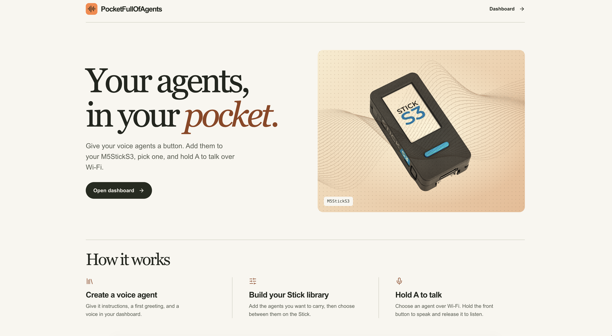
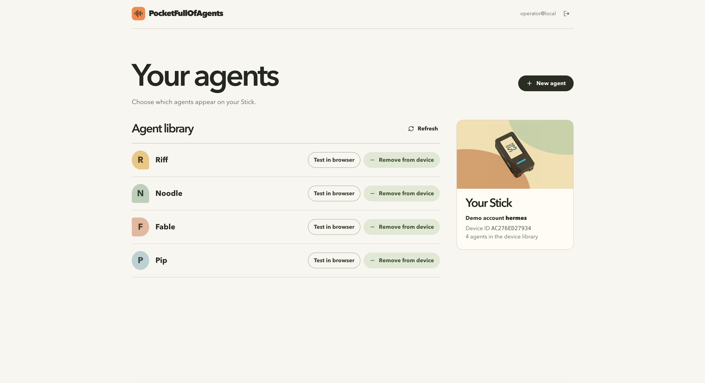
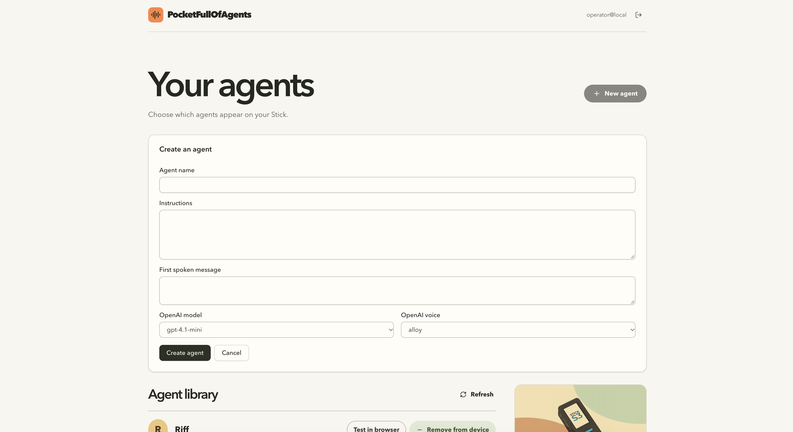

# PocketFullOfAgents

A reusable M5StickS3 voice client backed by Agora Conversational AI Platform
v3 management and a Next.js control plane.



The repository combines two upstream foundations:

- The Agora Platform v3 Next.js quickstart remains the root web application
  and source of truth for stored agent definitions.
- The M5StickS3 ESP-IDF/RTSA Lite recipe lives in
  `firmware/m5-sticks3/`. Its FastAPI control service was intentionally not
  imported; compatible device routes belong in Next.js.

Real-time audio flows directly between the device and Agora. Next.js owns
device authorization, short-lived credentials, agent assignment, and session
lifecycle; it must never proxy audio or return provider secrets to firmware.

## Repository map

```text
.
├── src/                         Next.js 16 / React 19 Platform v3 app
├── firmware/m5-sticks3/        ESP-IDF firmware and host tests
├── docs/
│   ├── architecture.md         system boundaries and compatibility gate
│   ├── device-protocol.md      exact current firmware HTTP contract
│   └── hardware-setup.md       macOS toolchain, build, and flashing
├── scripts/check-prereqs.mjs   non-secret local readiness check
└── env.example                 server-only configuration template
```

## Current status

The ESP-IDF 6 firmware builds for M5StickS3. The Next.js app assigns an Agora stored agent to the Stick and implements the RTC control routes. The remaining hardware check is a conversation with microphone and speaker audio after flashing the configured firmware.

## Web setup and build

Requirements: Node.js 20+, pnpm 11, an Agora project with Conversational AI
and App Certificate enabled, and optionally Agora Console credentials for the
project picker.

```bash
pnpm install --frozen-lockfile
cp env.example .env.local
```

Set at least these server-only values in `.env.local`:

```dotenv
APP_ENV=development
AUTH_MODE=bypass
AGORA_APP_ID=
AGORA_APP_CERTIFICATE=
```

Do not prefix the App Certificate or other secrets with `NEXT_PUBLIC_`.

```bash
pnpm check:prereqs
pnpm verify
pnpm dev
```

The development launcher prints the selected local URL and moves to the next
available port in bypass mode. `pnpm verify` runs contract tests, ESLint, and
the production build.

The v3 management UI and routes are preserved. Device API/session work should
be added as a narrow adapter, not as a second agent CRUD system. See
`docs/architecture.md` and `docs/device-protocol.md` before implementing it.

## Firmware setup, build, and flash

Follow `docs/hardware-setup.md` for the complete macOS ESP-IDF v6.0.3 setup.
The short form, after the toolchain is installed, is:

```bash
cd firmware/m5-sticks3
. ./esp-idf/export.sh
python3 tools/bootstrap_dependencies.py --check
cp main/voice_config.local.example.h main/voice_config_local.h
idf.py set-target esp32s3
idf.py build
idf.py -p /dev/cu.usbmodem1101 flash monitor
```

`main/voice_config_local.h` is ignored. Put Wi-Fi and the computer's reachable
LAN URL there; never commit it. Do not use `localhost` as the device server
address.

Host checks that do not require credentials or hardware:

```bash
pnpm test:firmware-host
```

The imported audio-test launcher had a one-directory relative-path defect; it
is corrected in this workspace so the root host-test command runs both suites.

## Python policy

The runtime control plane is Next.js, not Python. When firmware support tools
need third-party Python packages, use a local virtual environment and invoke
Python 3 explicitly:

```bash
python3 -m venv .venv
source .venv/bin/activate
python3 -m pip install -r <requirements-file>
```

Never install project packages into the system Python and never use a bare
`python` command.

## Security

- Keep App Certificates, provider credentials, Console secrets, Wi-Fi
  passwords, session tokens, and secret-set values out of Git and logs.
- Return only assigned agent display metadata to a device.
- Validate device identity and agent assignment before starting a session.
- Use short-lived RTC credentials and idempotent server cleanup.
- Preserve the license and third-party notices under `firmware/m5-sticks3/`.

## Stick operator dashboard



Production defaults to one operator with a server-side `OPERATOR_ACCESS_KEY`.
Sign in and select **New agent** to enter its name, instructions, and first
spoken message. Choose a managed OpenAI text model and TTS voice. The editor
saves the ARES → OpenAI → OpenAI TTS cascade in the configured Agora project.



Use **Push to device** and **Remove from device** to manage the Stick’s library. The server saves its ordered agent IDs in a private Vercel Blob. The Stick syncs over HTTPS with its provisioned device key. Select a voice agent on the Stick, then hold the front button to speak. Release it to listen. Settings show the device ID, volume, and simulated account `hermes`.

The operator login and logout endpoints accept POST requests at
`/api/auth/operator` (JSON with a `key` field) and
`/api/auth/operator/logout`. The signed-in dashboard reads and updates
`/api/device/assignment` with GET, PUT, and DELETE. Both membership operations accept the stored agent's
`agentId`. Email sign-in and per-user device ownership are deferred.

The public landing page is at https://pocketfullofagents.vercel.app, and signed-in operators manage agents at /dashboard. The device photograph is from the [M5Stack StickS3 product documentation](https://docs.m5stack.com/en/core/StickS3).
